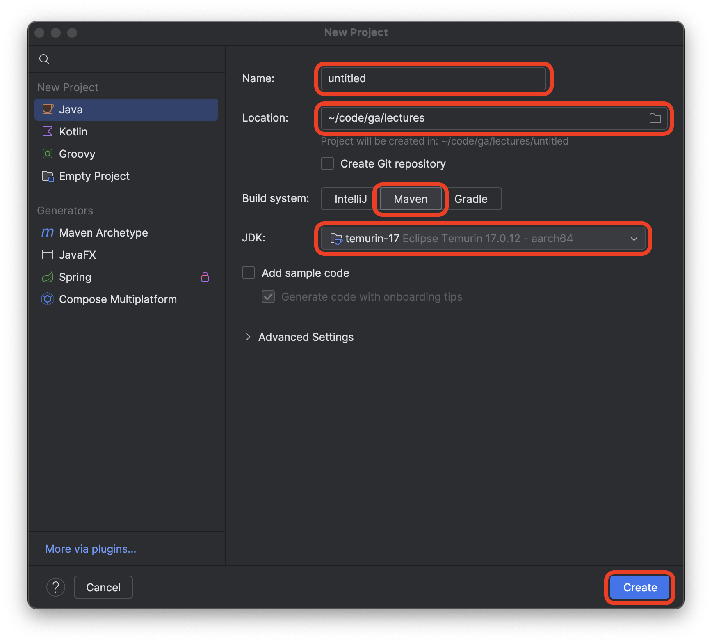

<h1>
  Java Test-Driven Development Lab
  Setup
</h1>

## Setup

Launch the IntelliJ IDEA application.

Select the **New Project** option.

Name the project `java-test-driven-development-lab`.

Create the project in the <code class="filepath">~/code/ga/labs</code> directory.

> ⚠️ Windows users, the <code class="filepath">labs</code> directory is likely at this location on your device: <code class="filepath">C:\Users\username\code\ga\labs</code> (replacing `username` with your username). Create the project in that directory instead.

Choose the **Maven** build system option.

Ensure the JDK used is **temurin-17**. This should be the default setting when starting a new project. If it's not, alert your instructor.

Ensure that the **Add sample code** option is not checked.

After confirming that the **New Project** window looks similar to the screenshot below, select the **Create** button. The name of the project should be `java-test-driven-development-lab`, not `untitled`.

We can get to work now that our project is set up.
